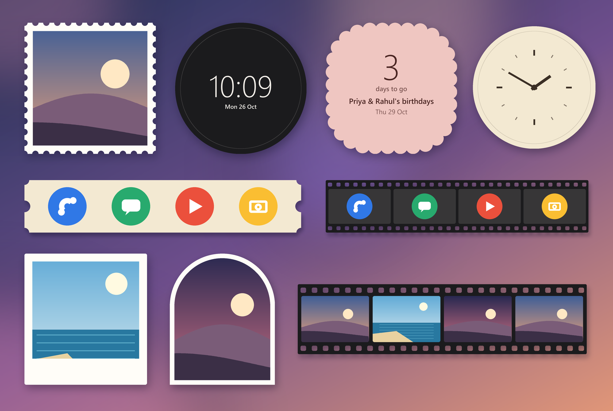
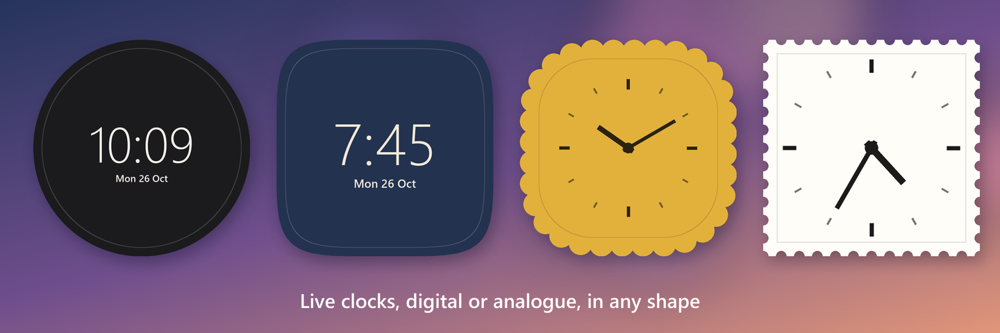
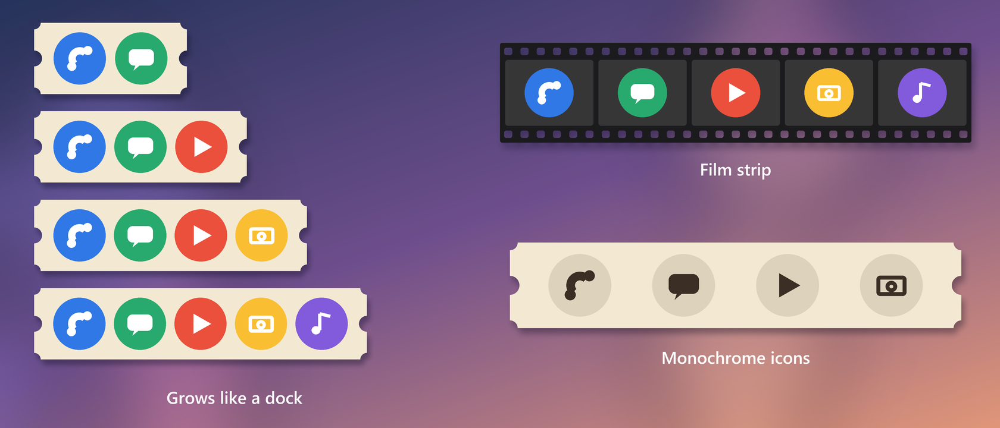
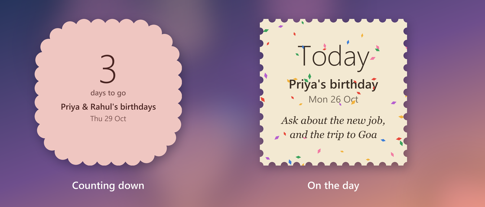
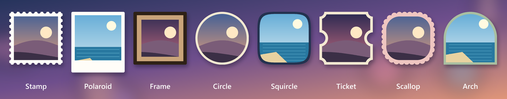

# Diecut

**Home-screen widgets cut to any shape.**

Android widgets are almost always rounded rectangles. Diecut makes widgets of your own
things (a photo, a clock, the apps you use most, the birthdays you don't want to miss)
in shapes a launcher never offers: a postage stamp with real perforations, a film strip,
a ticket, a polaroid, an arch. Where a shape cuts in, the wallpaper shows through.

A die cut is the printer's word for cutting paper into a shape.

## The widgets

Pick one from the widget list, or add it from the app. Each widget chooses its content,
shape and colours when it is added, and can be changed at any time.

### Photo
One picture, or up to ten that take turns: on a tap, or every half hour, hour, six
hours or day. Photos come through the system Photo Picker, so Diecut never asks to see
your gallery. In a film strip, each frame shows the next photo along.

### Clock
Live clocks in four digital styles, or analogue with hands drawn to match the shape.
The system keeps them ticking, so they cost no battery.

### Apps
Up to eight apps, each a tap away. The shape grows with every app, like a dock, until
it fills the widget. Resize the widget yourself and it fills the size you set instead.
Icons can be shown in full colour or in one colour, like themed icons.

### Dates
A countdown to birthdays, anniversaries and any day that matters: "3 days to go". One
widget can follow every date, or just the ones you pick. Dates on the same day are
named together. On the day it says so, confetti falls across the widget, the message
you saved ("ask about the new job") is there to remind you, and a tap opens a
celebration with a way to send your wishes. Dates come from your contacts or are
added by hand, and a reminder arrives at nine in the morning.

## Shapes

Stamp, film strip, polaroid, frame, circle, squircle, ticket, scallop and arch, in nine
colours (paper, cream, kraft, ink, post red, navy, sage, blush, mustard) or two taken from
your wallpaper (Material You).

## Install

Diecut needs Android 12 or later. Download the APK from the
[latest build](../../actions/workflows/build.yml) (the `diecut-apk` artifact) or from
[Releases](../../releases), and open it on your phone. Each build installs over the
last one without losing your widgets.

## How it works

A widget's face is **one bitmap**, drawn on a `Canvas` and shown in an `ImageView`. The
shape is a `Path`, and its cut-outs are holes made with `Path.op(…, DIFFERENCE)` on an
`ARGB_8888` bitmap, so the launcher shows the transparency as it is and the wallpaper
comes through. What a bitmap can't do is laid over it in the `RemoteViews`:

- **Clocks**: a `TextClock`, or an `AnalogClock` whose hands are bitmaps drawn to match.
- **Taps**: invisible buttons moved over each drawn icon with `setViewLayoutMargin`
  (Android 12+), so taps land where things are drawn.
- **Confetti**: an animated vector in a `ProgressBar`, which the launcher keeps playing.

The editor's live preview uses the same drawing code as the widget. The code is
Kotlin, with Jetpack Compose for the app's screens.

**Privacy.** Diecut has no internet access. Photos are copied into the app's own
storage; contacts are read only when you import dates, and only on your phone.

## Building

The APK is built by [GitHub Actions](.github/workflows/build.yml) on every pull
request and push to `main`; no local Android toolchain is needed. Pushing a `v*` tag
attaches the APK to a release. The release key comes from the `DIECUT_KEYSTORE_B64`
and `DIECUT_KEYSTORE_PASSWORD` secrets, so each build installs over the last.

`tools/art.py` draws the launcher icon, the widget picker previews and the confetti;
`tools/showcase.py` draws the pictures in this README.

## Not yet

- **Reshaping other apps' widgets.** It can be done (host the other widget out of
  sight, snapshot it and cut the snapshot), but taps become one tap, lists don't
  scroll, nothing animates and keeping it current costs battery. Maybe later, as
  "Frame another widget (beta)".
- More shapes: torn paper, speech bubble, hexagon, gift tag.

## Where this came from

The postage-stamp widget in [TomeVoice](https://github.com/Sayandeep1013/TomeVoice)
(the "Now reading (stamp)" widget, added in 1.0.6) proved the technique on a Nothing
Phone.
